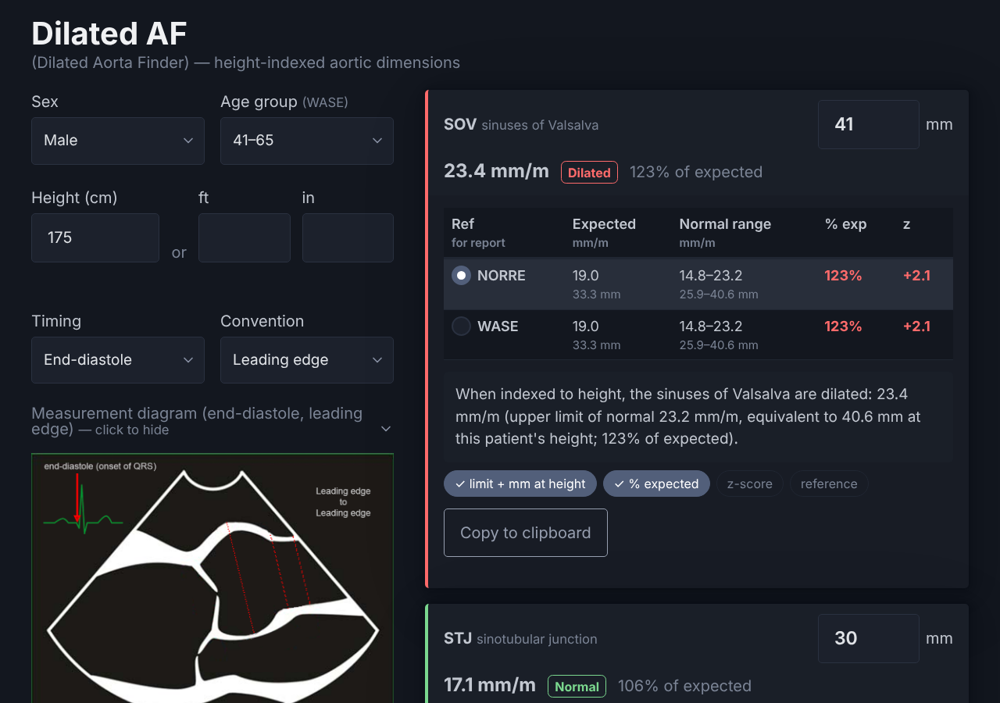

# Dilated AF (Dilated Aorta Finder)

**Live tool: [parameterz.github.io/dilated-af](https://parameterz.github.io/dilated-af/)**

A single-page reference for the adult aortic root and proximal ascending aorta, indexed to height.

It's built for a common situation at the echo machine: the aorta *looks* big, but indexing to body surface area says it's normal. Height indexing avoids the BSA problem (BSA rises with weight, which shrinks the indexed value in larger patients). This page gives the height-indexed answer, along with a sentence you can paste straight into the report.

## What it does

- **Reference ranges at this patient's height.** Enter sex, age group and height (cm or ft/in). Each segment card shows its normal range in mm.
- **Measured values, interpreted.** Enter a measurement on a card to see:
  - index (mm/m) and whether it is **normal, dilated or small** (mean ± 2 SD)
  - expected value and normal range, in mm/m and in mm at this height
  - **% of expected** (index ÷ reference mean) and **z-score**
- **NORRE and WASE side by side** where both apply, with a radio button to choose which one the report statement uses.
- **Copy-ready report text**, for example:
  > When indexed to height, the sinuses of Valsalva are dilated: 23.4 mm/m (upper limit of normal 23.2 mm/m, equivalent to 40.6 mm at this patient's height; 123% of expected).

  Chips turn the parts of the sentence on or off (limit and mm at height, % expected, z-score, reference). You can edit the text in place before copying, or use **Copy all statements** to copy every card at once.
- **Both timings and both edge conventions** from NORRE (end-diastole and mid-systole, leading edge and inner edge), with a measurement diagram for each. End-diastole inner edge also includes the short-axis sinus-to-commissure dimensions.
- Your settings (timing, convention, chips, reference choice, diagram shown or hidden) are remembered in the browser. Patient data is not saved and never leaves the page.
- Prints cleanly (black and white, no controls).

## References

| | Segments | Timing / convention | Stratified by |
|---|---|---|---|
| **NORRE** | SOV, STJ, AAO (+ sinus-to-commissure) | End-diastole or mid-systole; leading or inner edge | Sex |
| **WASE** | SOV, STJ | End-diastole, leading edge only | Sex, age group (18–40, 41–65, >65) |

- Saura D, et al. Two-dimensional transthoracic echocardiographic normal reference ranges for proximal aorta dimensions: results from the EACVI NORRE study. *Eur Heart J Cardiovasc Imaging*. 2017;18(2):167–179. [doi:10.1093/ehjci/jew053](https://doi.org/10.1093/ehjci/jew053)
- Patel HN, et al.; WASE Investigators. Normal values of aortic root size according to age, sex, and race: results of the World Alliance of Societies of Echocardiography Study. *J Am Soc Echocardiogr*. 2022;35(3):267–274. [doi:10.1016/j.echo.2021.09.011](https://doi.org/10.1016/j.echo.2021.09.011)

Reference values are in [`scripts/data.js`](scripts/data.js) (mean and SD, mm/m). WASE values are from Table 3 of the paper.

## Notes

- Limits are mean ± 2 SD of the height-indexed value. A value is flagged when its rounded index (0.1 mm/m) falls outside that range.
- This is a reference aid, not a diagnostic device. Use it alongside clinical judgment and your lab's own standards.

## Previous version

The original two-page version (upper limits only) is still available at [parameterz.github.io/dilated-af/v1/](https://parameterz.github.io/dilated-af/v1/) and as release [v1.0](https://github.com/parameterz/dilated-af/releases/tag/v1.0).

## Running locally

No build step and no dependencies: clone the repo and open `index.html` in a browser.

## Author

[Dan Dyar, MA, ACS, RDCS, FASE](https://www.linkedin.com/in/dan-dyar-ma-acs-rdcs-ae-pe-fe-fase/)

Reference images modified from [Oxborough et al.](https://echo.biomedcentral.com/articles/10.1530/ERP-14-0004) and [Saura et al.](https://doi.org/10.1093/ehjci/jew053), used under [CC BY 4.0](https://creativecommons.org/licenses/by/4.0/).
